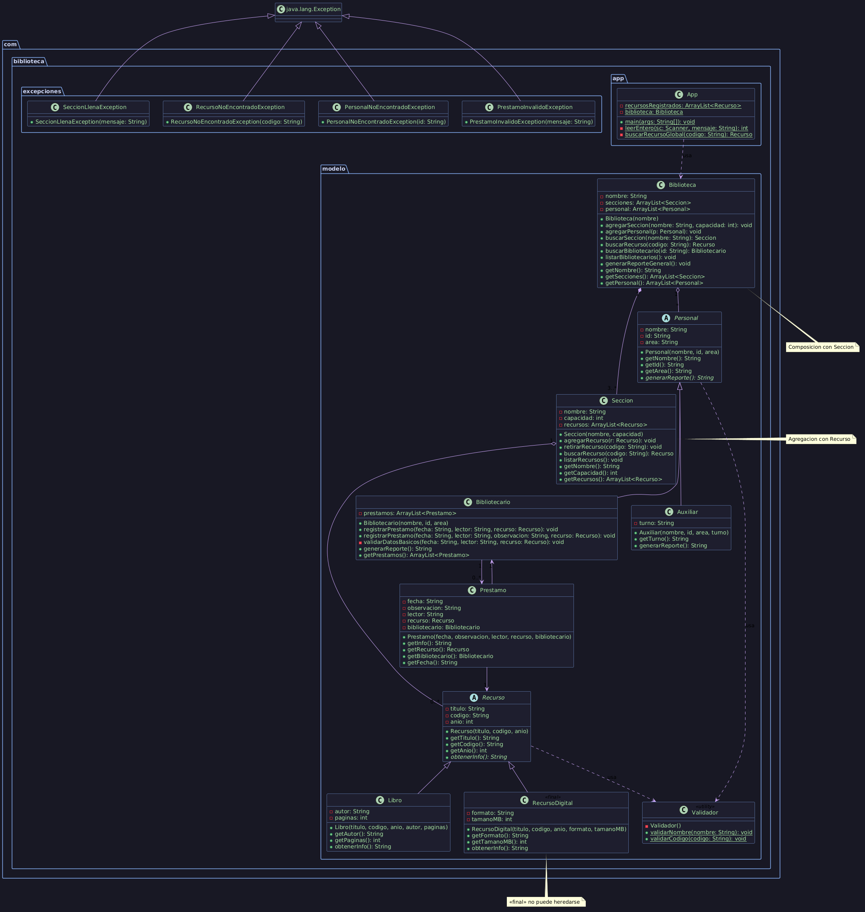

# Sistema de Gestión de Biblioteca Universitaria

Proyecto final de Programación Orientada a Objetos (Java, consola).

**Integrantes:** _(completar)_

## Estructura

```
SistemaBiblioteca/
├── README.md
├── diagrama-biblioteca.puml        ← diagrama de clases (PlantUML)
├── diagrama-biblioteca-plantuml.png ← imagen del diagrama
└── src/com/biblioteca/
    ├── modelo/        Personal, Bibliotecario, Auxiliar, Recurso, Libro,
    │                  RecursoDigital, Prestamo, Seccion, Biblioteca, Validador
    ├── excepciones/   SeccionLlena, RecursoNoEncontrado,
    │                  PersonalNoEncontrado, PrestamoInvalido
    └── app/           App (menú principal)
```

## Compilar y ejecutar

Desde la carpeta `SistemaBiblioteca`:

```bash
javac -encoding UTF-8 -d bin $(find src -name "*.java")
java -cp bin com.biblioteca.app.App
```

En Windows (PowerShell):

```powershell
javac -encoding UTF-8 -d bin (Get-ChildItem -Recurse src -Filter *.java).FullName
java -cp bin com.biblioteca.app.App
```

También se puede abrir la carpeta `src` como proyecto en NetBeans, IntelliJ o VS Code y ejecutar `App`.

## Diagrama de clases

Generado con PlantUML a partir de `diagrama-biblioteca.puml`:



## Conceptos de POO aplicados

| Concepto | Dónde |
|---|---|
| Clases abstractas | `Personal` (`generarReporte()`), `Recurso` (`obtenerInfo()`) |
| Clase `final` | `RecursoDigital` |
| Herencia | `Bibliotecario`, `Auxiliar` ← `Personal`; `Libro`, `RecursoDigital` ← `Recurso` |
| Encapsulamiento | Todos los atributos `private`; las subclases usan los getters heredados |
| Polimorfismo estático (sobrecarga) | `Bibliotecario.registrarPrestamo(...)` con 3 y 4 parámetros |
| Polimorfismo dinámico (sobreescritura) | `generarReporte()` en `Biblioteca.generarReporteGeneral()`; `obtenerInfo()` en `Seccion.listarRecursos()` y en la opción 2 del menú |
| Composición | `Biblioteca` crea sus `Seccion` en el constructor y en `agregarSeccion()` (App nunca hace `new Seccion`) |
| Agregación | `Seccion` guarda `ArrayList<Recurso>`; los recursos existen antes y fuera de la sección |
| Asociación | `Prestamo` une un `Bibliotecario` con un `Recurso` real (nunca `null`) |
| Excepciones personalizadas | 4 excepciones checked en `com.biblioteca.excepciones` |
| Validación centralizada | `Validador.validarNombre()` y `Validador.validarCodigo()` (constructor privado, métodos estáticos) |
| Entrada robusta | `App.leerEntero()` captura `InputMismatchException` y limpia el buffer |

## Decisión de equipo: búsqueda de recursos para préstamos

`Biblioteca.buscarRecurso(codigo)` solo encuentra recursos **ubicados en una sección**.
Decidimos **no exigir** que el recurso esté ubicado para prestarlo. `App.buscarRecursoGlobal(codigo)`:

1. Busca primero en las secciones con `biblioteca.buscarRecurso(codigo)`.
2. Si lanza `RecursoNoEncontradoException`, busca en la lista `recursosRegistrados`.
3. Si tampoco está ahí, vuelve a lanzar la excepción original, y el menú muestra `Error: Recurso con código X no encontrado.`

**Por qué:** un recurso recién registrado (por ejemplo, un libro que aún está en catalogación) ya existe en la biblioteca y puede prestarse; obligar a ubicarlo primero agregaría un paso que el usuario no siempre necesita. Con esta decisión, el préstamo siempre recibe un objeto `Recurso` real.

La opción 8 (buscar por código) sigue la misma lógica e indica si el recurso está *ubicado en sección* o solo *registrado, sin sección*.

## Validaciones adicionales (fuera del enunciado mínimo)

- **Opción 1:** no permite registrar dos recursos con el mismo código.
- **Opción 3:** no permite ubicar un mismo recurso en dos secciones.
- **Opción 10:** no permite crear una sección con nombre vacío ni duplicado (lanza `IllegalArgumentException`, que se captura).
- La búsqueda de secciones por nombre no distingue mayúsculas de minúsculas.

## Escenarios de prueba sugeridos para la demostración

| # | Escenario | Resultado esperado |
|---|---|---|
| 1 | Escribir `abc` en el menú | "Entrada inválida: debe ingresar un número entero." |
| 1 | Tipo de recurso `3` | "Tipo inválido" |
| 1 | Código `L 01` / año `1300` / páginas `0` / MB `0` / título vacío | Mensaje de `IllegalArgumentException` correspondiente |
| 3 | Sección `Inexistente` | "la sección 'Inexistente' no existe." |
| 3 | Crear sección `Mini` con capacidad 1 y ubicar 2 recursos | `SeccionLlenaException`: "Sección Mini sin espacio disponible." |
| 4 | ID `B009` o `A001` (auxiliar) | `PersonalNoEncontradoException` |
| 4 | Código inexistente | `RecursoNoEncontradoException` |
| 4 | Fecha / lector / observación vacíos | `PrestamoInvalidoException` |
| 4 | Préstamo con y sin observación | Demuestra la sobrecarga de `registrarPrestamo` |
| 7 | Código que no está en la sección | `RecursoNoEncontradoException` |
| 9 | Reporte general | Ocupación de cada sección y `generarReporte()` polimórfico de cada persona |
| 10 | Capacidad `0` | "Capacidad debe ser mayor a 0." |
